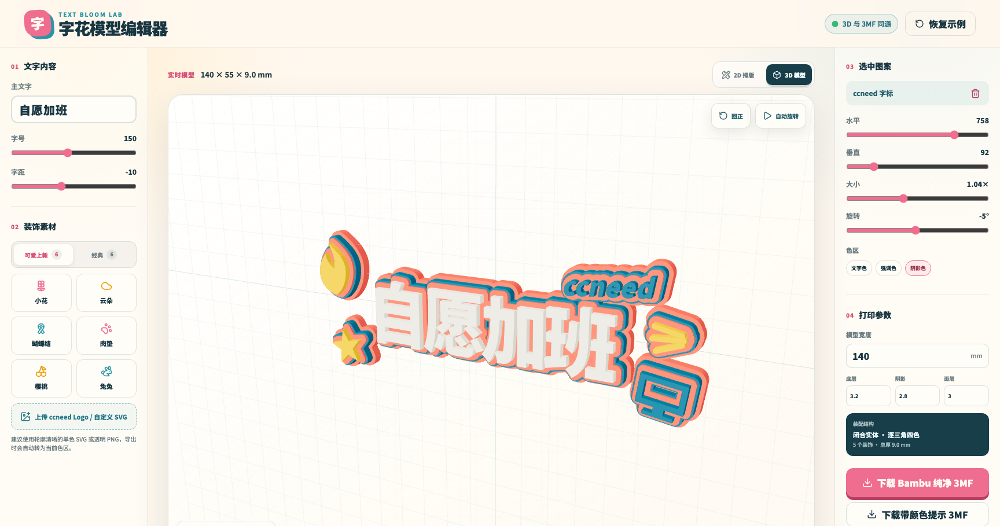
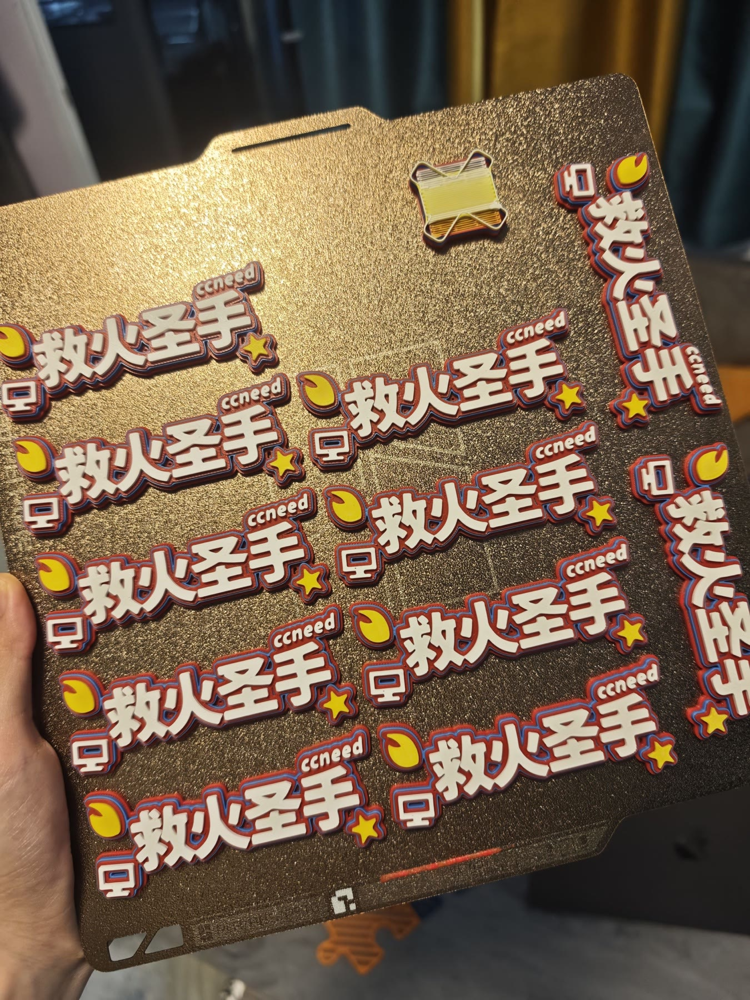
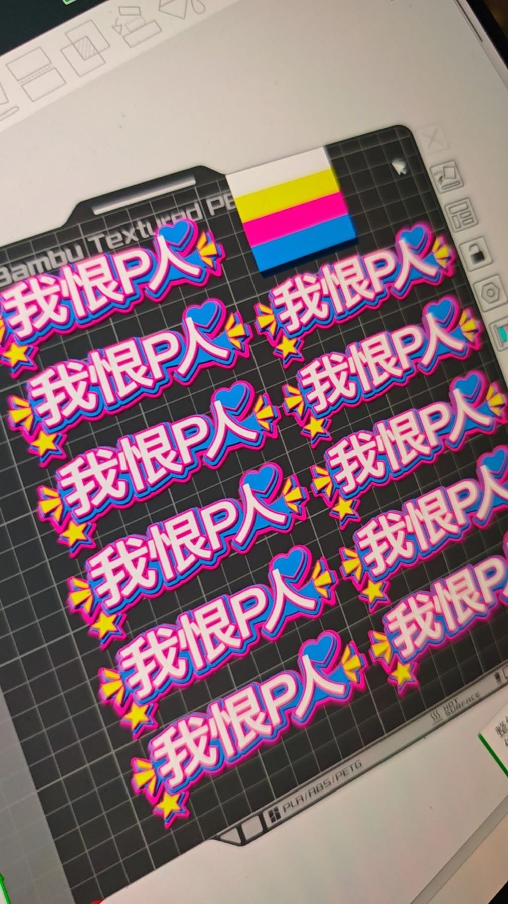

# Text Bloom Model Editor

Text Bloom is an open-source browser editor that turns Chinese text, logos, and decorative shapes into colored, watertight 3MF models for 3D printing.


> The hero is AI-generated concept artwork. The editor view, slicer screen, and printed objects below are real.

## Features

- Edit text, font size, letter spacing, and final model width.
- Move, scale, and rotate built-in decorations.
- Import an SVG or transparent PNG up to 2 MB.
- Configure four color regions and three solid layer heights.
- Inspect the actual mesh in an orbitable Three.js viewport.
- Export a clean multipart 3MF without filament presets by default, with an optional standard color-hint 3MF.
- Generate the 3D preview and exported 3MF from the same watertight mesh pipeline.

## Real results



<table>
  <tr>
    <td width="33%"></td>
    <td width="33%"></td>
    <td width="33%"></td>
  </tr>
  <tr>
    <td align="center">Batch print</td>
    <td align="center">Bambu Studio layout</td>
    <td align="center">Finished prints</td>
  </tr>
</table>

## Example downloads

- [自愿加班 · Bambu-clean four-part 3MF](examples/models/zi-yuan-jia-ban-bambu-clean.3mf)
- [我恨P人 · Bambu-clean four-part 3MF](examples/models/wo-hen-p-ren-bambu-clean.3mf)

Both files were generated by the editor's real export pipeline. They retain independently assignable parts but contain no color resources, filament presets, or machine settings. Part names include the intended slot and hex color as manual mapping hints. Verify dimensions and assign your existing filaments in the slicer before printing.

## Local development

Node.js 22.13 or later is required.

```bash
git clone https://github.com/TANGXTONG1/text-bloom-model-editor.git
cd text-bloom-model-editor
npm ci
npm run dev
```

Validation:

```bash
npm run check
```

Static export at the domain root:

```bash
PUBLIC_ORIGIN=https://example.com npm run export:self-hosted
```

Static export below a subpath:

```bash
PUBLIC_ORIGIN=https://example.com \
BASE_PATH=/text-model-editor \
npm run export:self-hosted
```

The generated site is written to `static-site/`.

## Printing notes

Open the recommended Bambu-clean 3MF in Bambu Studio and assign an existing filament to every named part. The optional standard color-hint export may trigger Bambu Studio's color-mapping dialog and temporary custom filaments. Start with a small test print, especially when the design contains thin strokes, small holes, or a custom SVG.

See [docs/PRINTING_GUIDE.md](docs/PRINTING_GUIDE.md) for more details.

## Privacy

Imported SVG and PNG files are read and processed locally in the browser. The app does not include an upload endpoint or database.

## License

- Source code: [MIT](LICENSE)
- Original decorative artwork, example models, and visual assets: [CC BY 4.0](LICENSES/MODEL-ASSETS.md)
- Third-party fonts, logos, uploads, and generated models remain subject to their respective rights and licenses.

Contributions are welcome. Please read [CONTRIBUTING.md](CONTRIBUTING.md) first.
