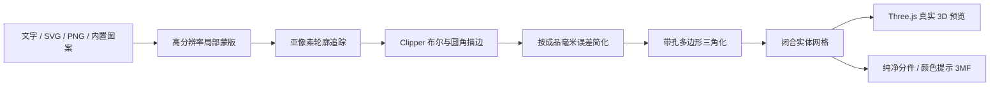

# 架构与几何管线

## 目标

字花模型编辑器不是 CAD 的完整替代品。它专注于一个明确场景：把浏览器里的中文排版、Logo 与小图案可靠地转换为适合 FDM 打印的分层彩色实体。

核心约束有三条：

1. 3D 预览和 3MF 不能走两套生成逻辑。
2. 每一个导出色区都必须是独立、闭合的实体网格。
3. 浏览器端处理用户素材，不需要上传服务器。

## 主要模块

| 文件 | 职责 |
| --- | --- |
| `app/ModelEditor.tsx` | 编辑状态、2D 画布、素材导入和界面 |
| `app/model-geometry.ts` | 蒙版追踪、布尔运算、描边、三角化和实体网格 |
| `app/three-mf.ts` | 纯净分件与标准颜色提示两种 3MF 打包模式 |
| `app/ModelViewport.tsx` | Three.js 场景、相机和旋转交互 |
| `app/preview-geometry.ts` | 把导出网格转换为 Three.js BufferGeometry |
| `app/cute-decorations.ts` | 可复用的 Canvas 路径装饰素材 |
| `scripts/export-self-hosted.mjs` | 生成可放在根路径或子路径的静态站点 |

## 从像素到实体

### 1. 排版与高分辨率蒙版

编辑器先把文字、内置图案和用户素材绘制到独立的 Canvas 蒙版。每一个元素使用自己的裁切区域和世界坐标原点，避免为了一个小图案反复分配整张超大画布。

`MASK_SCALE` 控制轮廓采样分辨率。当前值为 3，在曲线质量和浏览器内存之间取平衡。

### 2. 亚像素轮廓追踪

`d3-contour` 从 alpha 蒙版中取得等值线。这里保留抗锯齿 alpha，而不是先把图像压成硬二值边缘，因此圆弧位置可以落在亚像素坐标上。

### 3. 布尔运算与描边

轮廓会进入 `clipper-lib`：

- `unionPaths` 合并重叠轮廓。
- `differencePaths` 保证文字、强调色和阴影色区互不占据相同面。
- `offsetPaths` 生成顶层包边、阴影层和底层外扩轮廓。

偏移使用圆角连接，并保持较小的圆弧容差。不要在这个阶段随意增加清理距离，否则小圆角和中文字口容易退化。

### 4. 按物理误差简化与带孔多边形三角化

高分辨率采样点对布尔运算和圆弧定位有价值，但不需要全部变成最终顶点。`meshForPaths` 根据 `widthMm` 把 **0.03 mm** 的成品误差换算回画布坐标，并在闭合环上执行保拓扑的折线简化。这样不会为了减面而降低 `MASK_SCALE`，也不会让不同成品尺寸承担不同的肉眼误差。

轮廓通过 PolyTree 识别外环和孔洞，再由 `earcut` 对顶面和底面三角化。侧壁按每条环的方向生成，最终得到：

- 顶面
- 底面
- 每一个外环侧壁
- 每一个孔洞侧壁

测试会统计无向边；闭合 two-manifold 网格的每条边必须恰好被两个三角形共享。

### 5. 两个消费者，一份网格

`meshForPaths` 的结果同时交给：

- `geometryFromMesh`：生成 Three.js 非索引几何，并为平面顶盖设置硬法线。
- `app/three-mf.ts`：写入同一组顶点、三角形和装配对象。

如果以后修改 3D 预览，请不要在视窗组件里重新三角化轮廓，否则会重新出现“网页预览和下载文件不一致”。

## 3MF 导出结构

推荐的 `clean` 模式只写 3MF Core：

- 每个色区一个独立 mesh object
- 对象名中的逻辑色槽与十六进制颜色提示
- 一个引用所有色区对象的 assembly object
- 不写 Materials 扩展、耗材/机器预设或切片参数

可选的 `standard` 模式额外写入四颜色 `m:colorgroup`，并在对象和三角形上设置标准颜色属性。Bambu Studio 会据此启动自己的颜色映射流程，部分版本可能追加临时自定义耗材，因此它不是默认模式。

两种模式都不嵌入 Bambu 专有项目配置。AMS 槽位属于用户本机配置，打印前始终要核对材料映射。

## 性能边界

最昂贵的阶段是高分辨率蒙版读取、等值线追踪和复杂轮廓布尔运算。性能优化应优先考虑：

1. 把几何构建移到 Web Worker。
2. 缓存未修改元素的轮廓。
3. 给 SVG 提供节点数或路径复杂度提示。
4. 保持 2D 编辑交互轻量，只在停顿后重建 3D。

不要单纯降低 `MASK_SCALE` 来换速度；这会直接损害打印圆弧。
