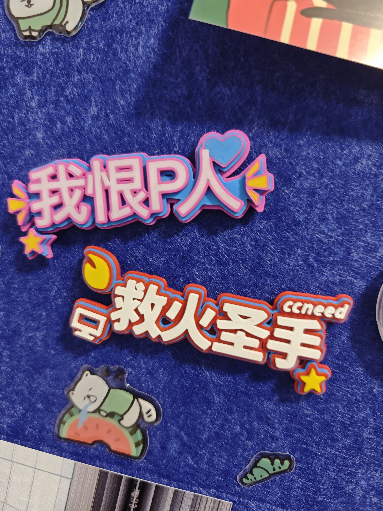
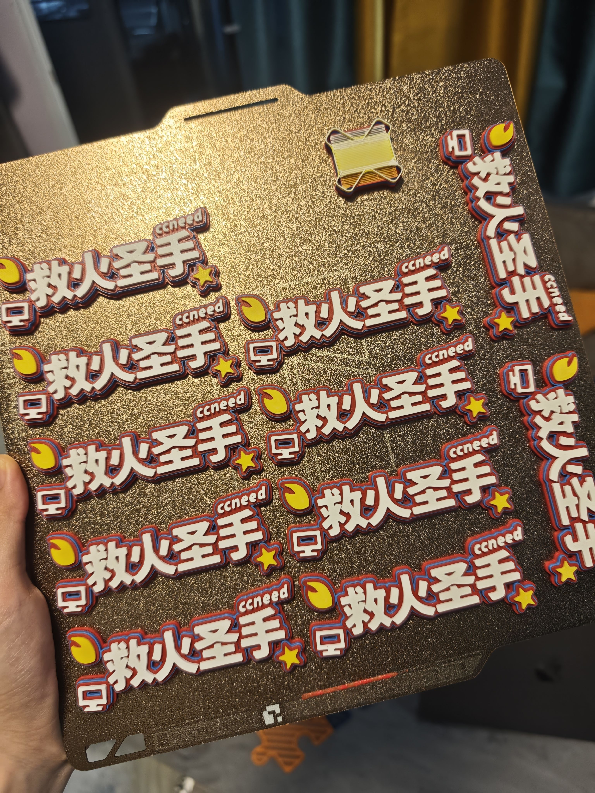
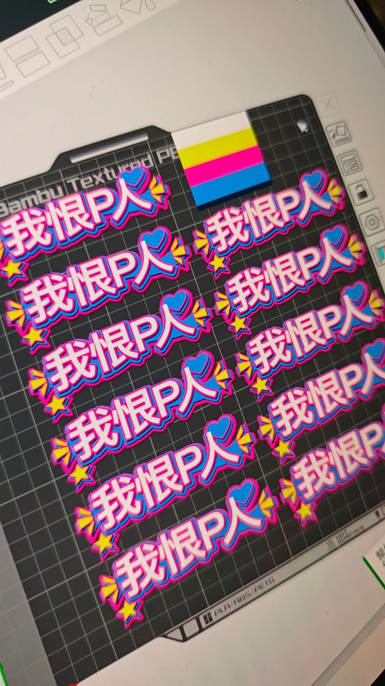

# 首发宣传文案包

## 小红书标题备选

1. 为了给公司整点活，我做了个中文彩色 3D 字牌生成器
2. 上手 3D 打印先别打船：我先给同事做了块梗牌
3. 把公司群里的梗，直接变成四色 3MF 了
4. “救火圣手”有实体周边了，而且生成器开源
5. 中文、Logo、火苗全能拖：这个 3D 打印小工具我开源了

推荐首发用第 1 个；封面大字可以写：

> 给公司整点好玩的 
> 中文梗牌生成器开源

## 小红书正文

最近刚开始认真玩 3D 打印，我给自己定的第一个目标不是打印船，也不是下载现成摆件——先给公司整点真正会被拿起来玩的东西。

于是做了这个「字花模型编辑器」：输入中文，拖几个星星、火苗、电脑、爱心或者可爱图案，也能放自己的 SVG / 透明 PNG Logo；颜色和三层厚度都能调。网页里可以直接旋转看真实 3D，最后下载带颜色分区的 3MF，扔进 Bambu Studio 映射 AMS 就能打。

第一块先做了“救火圣手”。这种带点内部梗的同事称号，挂工位、包上或者活动现场都比普通名牌有意思。下一步准备做“需求终结者”“会议救星”“上线守夜人”……

这个项目折腾最久的其实不是界面，而是模型：早期网页预览和下载文件不是同一套逻辑，圆弧会变方，布尔运算还会冒出奇怪三角面。现在 3D 视窗和 3MF 已经共用同一份闭合网格，也补了颜色资源和几何测试。

代码已经用 MIT 开源，原创示例模型用 CC BY 4.0。想自己改图案、加公司内部玩法，或者单纯拿来学浏览器建模都可以。

- 在线编辑器：[上线后填链接或放主页]
- GitHub：<https://github.com/TANGXTONG1/text-bloom-model-editor>
- MakerWorld：[发布后填链接]

提醒一下：带公司 Logo 的公开版本一定先确认授权；第一次打印也要在 Bambu Studio 里核对尺寸和四个耗材槽位。

#3D打印 #拓竹 #BambuLab #MakerWorld #开源项目 #办公室好物 #打工人日常 #程序员 #创客 #公司文化

## 置顶评论

> 大家最想给同事做什么四字称号？我先收一波词，后面挑几个做成同一套预设。项目链接在正文；如果遇到 3MF 颜色或 SVG 建模问题，带截图来提 Issue。

## 30 秒视频脚本

| 时间 | 画面 | 字幕 / 旁白 |
| --- | --- | --- |
| 0–3 秒 | 手里晃一下成品，快速切工位场景 | 上手 3D 打印，我先给公司整点活 |
| 3–7 秒 | 输入“救火圣手” | 中文直接改 |
| 7–12 秒 | 拖火苗、电脑、星星，换颜色 | Logo 和图案也能拖 |
| 12–16 秒 | 旋转 3D 视窗看侧面 | 看的就是实际导出网格 |
| 16–20 秒 | 点击下载，在 Bambu Studio 显示四色对象 | 导出带色区的 3MF |
| 20–26 秒 | 打印延时 + 揭板 | 四色打印，平放通常不用支撑 |
| 26–30 秒 | 成品和 GitHub 页面同框 | 编辑器和代码都开源了 |

## 拍摄清单

- 封面：手持成品，文字正对镜头，背景带一点公司工位氛围。
- 屏幕录制：改字、拖图案、换色、旋转 3D、下载，全部在 8 秒内。
- 切片画面：四个对象与 AMS 槽位同屏。
- 打印延时：保留第一次出现面层颜色的瞬间。
- 揭板：从热床拿起，转到侧面展示分层。
- 使用场景：工位、背包、会议室门牌三选一。
- 结尾：GitHub README 和 MakerWorld 模型页，避免二维码铺满画面。

### 现有图片的发帖顺序

<table>
  <tr>
    <td width="33%"></td>
    <td width="33%"></td>
    <td width="33%"></td>
  </tr>
  <tr>
    <td align="center">1. 成品钩子</td>
    <td align="center">2. 真实打印证明</td>
    <td align="center">3. 切片过程</td>
  </tr>
</table>

第 4 张放 `public/og.png` 或实际网页全屏截图，第 5 张再放 GitHub README。这样叙事顺序是“先看到好玩的东西 → 证明真的打出来了 → 展示怎么做 → 最后给工具和源码”。

## 公司群版本

> 给公司整了个小玩具：输入同事称号 + 拖 Logo / 火苗 / 电脑，就能直接生成四色 3MF。第一块“救火圣手”已经出炉。大家把想做的四字称号丢群里，我挑几块先打；编辑器也开源了，懂前端或 3D 的同学欢迎一起加图案。

## 朋友圈版本

> 上手 3D 打印的第一个正经项目：把公司内部梗做成彩色实体字牌。顺手把浏览器编辑器、3D 预览和 3MF 导出也做了，现在代码开源。比起继续囤模型，我更想看看同事们会发明出什么离谱称号。

## 发布节奏

1. **第 0 天**：GitHub 仓库、README、在线 Demo 同时可用。
2. **第 1 天**：MakerWorld 上真实打样模型和打印配置。
3. **第 1–2 天**：小红书发制作过程，不只发工具截图。
4. **第 3 天**：置顶一条“大家投稿的同事称号”评论。
5. **第 7 天**：发第二篇，展示 3–5 个公司实际玩法和失败样件复盘。

首发不要一次塞太多功能点。用户最容易理解的故事是：**“我想给公司整点好玩的，所以做了一个能把内部梗变成彩色 3D 字牌的开源工具。”**
